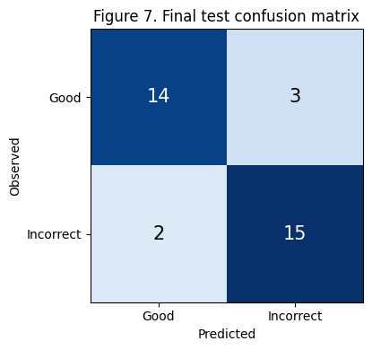
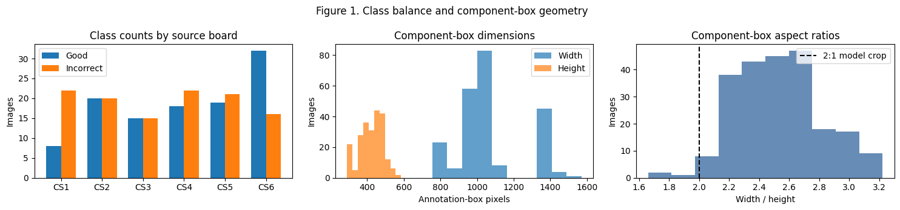
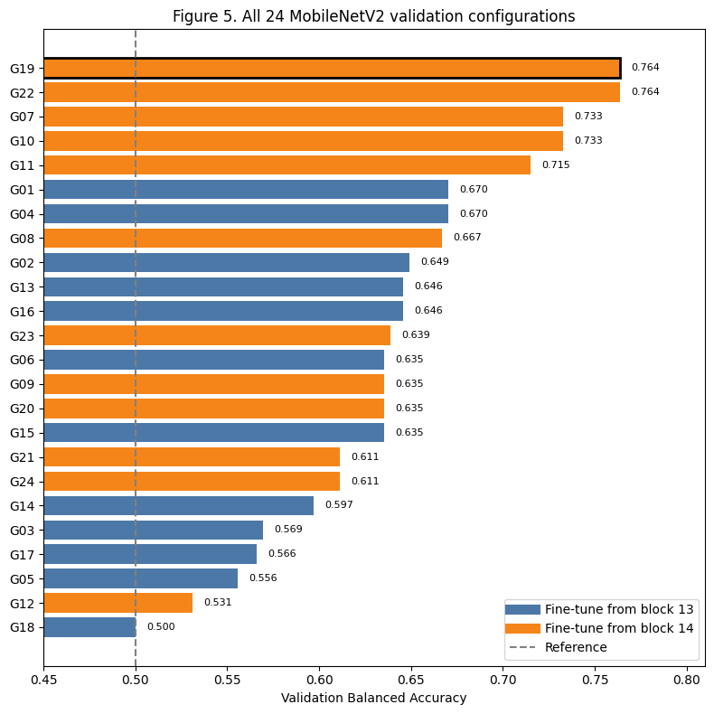
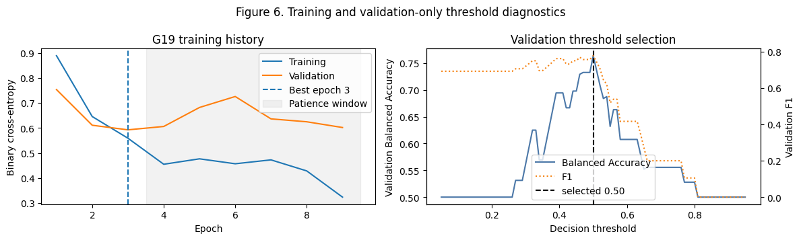

# PCB Component Placement Classification

Binary image classification of acceptable versus incorrect PCB component placement, using **ImageNet-pretrained MobileNetV2** and annotation-centred crops.

**Author:** [Mayur More](https://github.com/mayurmore0812). Academic portfolio project with a hypothetical manufacturing scenario.



## Explore

- [Notebook with saved results](PCB_Placement_Classification.ipynb)
- [Saved-results HTML report](reports/PCB_Placement_Classification.html): download and open locally.
- [Dataset, archive layout and setup](docs/DATA_AND_SETUP.md)
- [Model and preprocessing](docs/MODEL.md)
- [Evaluation, uncertainty and test history](docs/EVALUATION.md)
- [Sources and licences](THIRD_PARTY_NOTICES.md)

## Data and saved results

228 labelled V1 top-view images from six designs (CS1–CS6): 112 Good and 116 Incorrect. Stratified image-level partitions contain 160 training, 34 validation and 34 test images. **Every board design appears in every split.**

| Saved result | Value |
|---|---:|
| Selected configuration / threshold | G19 / 0.50 |
| Validation balanced accuracy / Incorrect F1 | 0.7639 / 0.7778 |
| Test balanced accuracy / Incorrect F1 | 0.8529 / 0.8571 |
| Correct Good / Incorrect | 14/17 / 15/17 |
| False positives / false negatives | 3 / 2 |
| Test balanced accuracy, 95% bootstrap interval | 0.7059–0.9706 |
| Incorrect F1, 95% bootstrap interval | 0.7273–0.9697 |

Evidence: notebook cells 11, 21 and 23; positions are one-based and include Markdown. These are historical saved results, not a newly trained reproduction. Confusion-matrix arithmetic agrees with the saved metrics.

**Evaluation scope:** unseen images of known board designs. Historical experiments also inspected test scores for ten configurations; validation is documented as the selection basis, but this is not a never-inspected confirmatory test. No production inspection performance or unseen-board generalization is established.

## How it works

Annotated photograph → 25%-margin, 2:1 component crop → 320×160 resize → training-only augmentation → MobileNetV2 with fine-tuning from `block_14_expand` → dropout 0.30 and sigmoid classifier → average four deterministic flip views → validation-selected threshold.





The chart displays historical scores for 24 configurations. The notebook reproduces the selected G19 model; it does not rerun the full grid search. G19 and G22 tie on validation metrics; G19 omits classifier L2.



The code allows 30 epochs and early-stopping patience of six. The saved best epoch is 3. Random augmentation is training-only; deterministic flip averaging applies to validation and test inference.

## Run locally

The saved notebook records Python 3.12.10, TensorFlow 2.21.0 and Keras 3.14.0. Package versions are not locked, and this upload copy has not been trained in a fresh environment.

```powershell
python -m venv .venv
.\.venv\Scripts\python.exe -m pip install -r requirements.txt
.\.venv\Scripts\python.exe -m jupyterlab
```

Download [SolDef_AI](https://www.kaggle.com/datasets/mauriziocalabrese/soldef-ai-pcb-dataset-for-defect-detection), name the compatible ZIP `archive.zip`, and place it beside the notebook. Start Jupyter from this repository root and run cells in order. Linux/macOS can use `.venv/bin/python` for the same commands. TensorFlow installation and accelerator support depend on the operating system and hardware.

The local archive is about 1.18 GB. The notebook reads archive images into memory and trains the classifier; peak RAM, runtime and accelerator requirements were not benchmarked. MobileNetV2 may download ImageNet weights on first use. No trained checkpoint is distributed or saved by this notebook.

## Limits and attribution

Cropping requires supplied annotation geometry; this classifier does not locate components automatically. Small test size, shared board designs and historical test exposure limit generalization. Bootstrap intervals describe resampling of the fixed test, not all model-selection uncertainty. No deployment, latency reduction, factory cost savings or real client engagement is claimed.

Dataset authors and paper: Fontana, Calabrese, Agnusdei, Papadia and Del Prete (2024), [SolDef_AI](https://doi.org/10.3390/jmmp8030117). Kaggle metadata lists the dataset as **GPL 3**. Dataset photographs shown in notebook/report figures remain third-party material; see [notices](THIRD_PARTY_NOTICES.md). No blanket licence is assigned to the project's analytical code.
